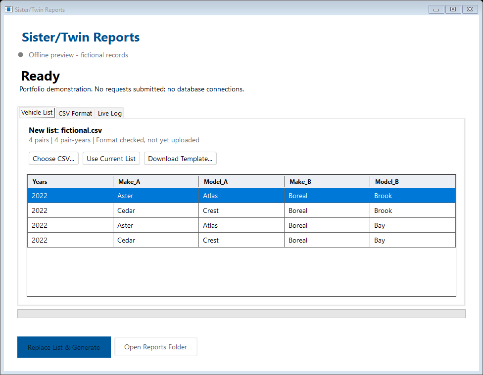
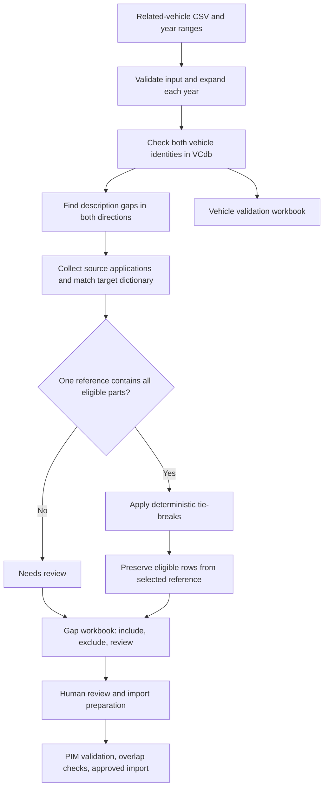
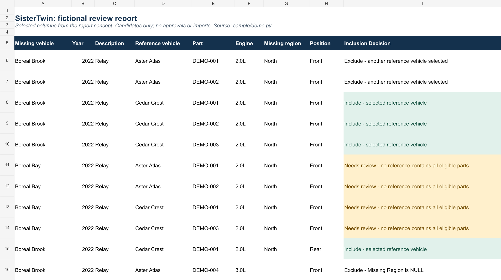

# SisterTwin Vehicles

**Turning automotive catalog knowledge into a repeatable coverage-review workflow.**

Automotive product managers and catalog teams need to know where an existing part may be missing from a related vehicle's catalog coverage. SisterTwin compares related vehicles, checks vehicle identities and target eligibility, and produces Excel reports that explain which candidates to include, exclude, or review.

**Initial business result: 60,000 additional application lines successfully imported into the catalog after cleanup and validation.** This project-owner-reported result counts application records, not unique parts, vehicles, or sales opportunities. It comes from the initial phase of the project and is separate from the current application's candidate-report counts.

I built SisterTwin from scratch after listening to the team's needs, translating automotive catalog knowledge into explicit analysis rules and a usable reporting workflow. The implementation combines SQL Server analysis, Python orchestration, and a C# Windows desktop interface.

**Repository scope:** a public case study and independently written, fictional-data educational sample. It does not contain the company's production implementation, catalog data, database connections, or an automatic catalog importer.



*Actual interface rendered from an isolated source copy in offline preview mode. Vehicle records are fictional, branding is omitted, and no requests or database operations were performed. The preview is not a live completed run.*

## From a team need to a usable tool

The business need was to turn related-vehicle knowledge into a systematic way to investigate missing catalog coverage. That requires comparing descriptions, checking source application details against target eligibility, and resolving competing reference vehicles. I built a workflow that makes those checks repeatable and exposes unresolved cases to the catalog team.

The desktop app lets users select a vehicle list, generate reports, follow the run log, and open the results without operating the underlying SQL scripts. The earlier team's exact tools and manual sequence are not documented here; no before/after time-saving claim is made.

## What an application line means

An application line associates a part with a vehicle and its fitment conditions. In this project that includes make, model, year, part number, description, and potentially engine, position, region, submodel, transmission, notes, and other qualifiers. For example, fictional part `DEMO-001` might have separate rows for different positions or engine conditions on the same vehicle. One part can therefore produce many application lines.

The analysis report adds reference-vehicle and missing-vehicle columns, grouping IDs, an expansion reason, and an inclusion decision. A report row is a **candidate based on an existing reference application**. It is not yet an approved target application or proof of physical interchangeability.

## Why sister/twin vehicles help

Related vehicles may share engineering or a platform, making them useful starting points for finding coverage gaps. A relationship is a research lead. It does not establish that every part, engine, trim, market, or model year is interchangeable.

SisterTwin separates three questions:

1. Does each make/model/year exist in VCdb, the vehicle configuration database?
2. Is a product description present on one vehicle and absent on its related vehicle?
3. Does the target vehicle dictionary support the reference application's engine text and return a region?

Those checks narrow the review work. Catalog specialists still evaluate fitment conditions and prepare, validate, and import approved records separately.

## Workflow



## The important engineering decision

The current algorithm compares **distinct eligible part sets before ranking engines**. For a target make/model/year/description, it forms the union of parts across eligible references. A reference can win only if it contains that entire union.

If A contains `{P1, P2}` and B contains `{P1, P2, P3}`, B wins. If A contains `{P1, P2}` and B contains `{P1, P3}`, neither is complete: the group requires review. The tool does not manufacture a combined reference by mixing those lists.

When multiple complete references remain, it prefers all-blank engines, then all-specified engines, then mixed engines; next, more eligible application rows; finally, make/model alphabetical order. Every eligible application row from the winner is preserved. Distinct parts determine completeness; application rows determine detail preservation and one tie-break.

See the [fictional worked example](docs/worked-example.md), [technical design](docs/technical-design.md), and [verification and limitations](docs/verification.md).

## Inspect the report output



The [fictional Excel examples](evidence/fictional-report-examples.xlsx) contain a compact gap report and an invented vehicle-validation fixture. They show selected fields and the real decision-label vocabulary in a simplified presentation, not a production export. The sample's 11 candidate rows yield four Include, three Exclude, and four Needs review decisions; none represents an approved import.

## Run the educational sample

Requires Python 3.10 or later; no database, account, or third-party packages.

```sh
python sample/demo.py
python -m unittest discover -s sample -v
```

The sample writes a fictional review report to `sample/output.json`. It demonstrates selection after gap discovery and dictionary matching. It does not implement VCdb, the full SQL pipeline, the production UI, or catalog import. Its string ordering is Python's ordering, not SQL Server collation.

## What the desktop application implements

| Layer | Responsibility |
| --- | --- |
| C# / .NET 8 Windows Forms | Preview and validate CSV input; submit requests; display worker status and live logs; open reports |
| Shared file queue | Publish complete requests, retain input snapshots, and communicate status |
| Python + pyodbc | Serialize runs, coordinate SQL stages and transfers, validate counts, handle failures |
| SQL Server | Expand years, validate identities, find gaps, match eligibility, select references |
| Python + openpyxl | Stream detailed Excel reports, preserve textual part numbers, publish both workbooks together |

The current workflow uses Python orchestration. Earlier SSIS experiments are not the deployed application architecture. The worker starts after Windows sign-in; it is not a Windows service or web API.

## Review boundaries

`Include` means the selection rule chose a reference. It does not mean the candidate is approved for catalog import. `Needs review` rows must not slip into a load by merely removing `Exclude` rows. Source qualifiers and overlaps need explicit review, followed by target-field preparation and PIM validation.

The most valuable next improvement is a traceable approval-to-import reconciliation: connect each candidate, reviewer decision, validation result, and imported record so business impact can be audited without confusing candidates with additions.
