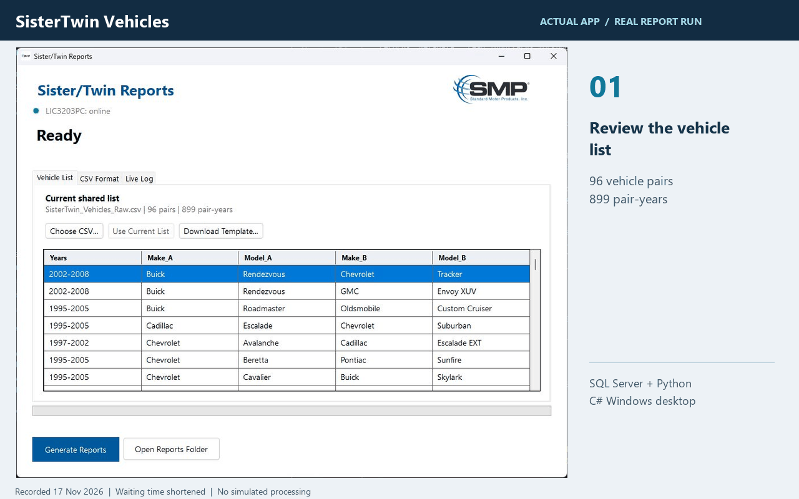
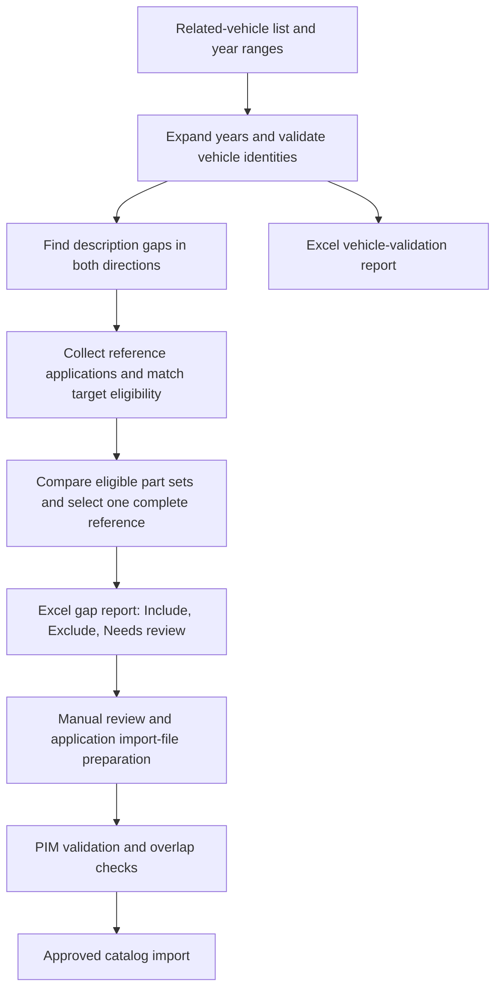

# Vehicle Application Coverage Tool

A desktop application that identifies where parts cataloged for one vehicle may also apply to a related vehicle but are missing from its catalog coverage. It validates vehicle identities against VCdb and produces reports supporting review and preparation of import files. The initial phase resulted in **62k additional application lines imported after cleanup and validation**.

The application is named SisterTwin in the source code and recorded interface. I built it from scratch after listening to the team's needs, using SQL Server, Python, and C#/.NET. The reports support subsequent manual review, import-file preparation, validation, and catalog loading.

The 62k result counts successfully imported application records from the initial phase, not unique parts or vehicles. It is separate from candidate counts produced by later versions of the analysis.

## See the app in use

*Recorded from the deployed app on November 17, 2026. This is a real report run using the existing vehicle list and actual results; no processing is simulated. Waiting time is shortened. The app and its setup were not modified for the recording.*

[Watch the recording as a video](assets/sistertwin-live.mp4) · [View a still image](assets/sistertwin-live.png)

## The catalog problem, in plain language

An automotive parts catalog does more than list products. It describes **which vehicles each part applies to, and under which conditions**. A relay might apply to a particular make, model, and year, with additional restrictions for its engine, installation position, region, transmission, or other characteristics.

An **application line** is one such part-to-vehicle record with its conditions. In SisterTwin's actual data model, the core fields include make, model, year, part number, and description, together with fields such as Engine, Position, Region, Submodel, Quantity, FootNote, and Note. The same part can have several application lines because different vehicle configurations or conditions need separate records.

A catalog can contain a part's application on one vehicle while lacking the equivalent product description on a related vehicle. That is a potential coverage gap worth investigating. It is not yet proof that the part fits, and it does not necessarily require developing a new product.

### Why sister/twin vehicles are useful

In this workflow, sister/twin vehicles are candidate related vehicles identified by the team's relationship list. They may share a platform, components, or engineering, which gives the catalog team a useful starting point for comparing coverage.

A relationship is not a blanket interchangeability rule. Model years, engines, trims, regions, positions, and application notes can differ. SisterTwin therefore checks vehicle identities and target eligibility at the application level, compares competing references, and makes unresolved cases visible for human review.

## What the tool takes in and produces

| Input | What it contributes |
| --- | --- |
| Vehicle-pair CSV | Two make/model combinations and an inclusive year range: `Years, Make_A, Model_A, Make_B, Model_B` |
| Existing catalog applications | The parts, descriptions, and detailed conditions already associated with reference vehicles |
| VCdb vehicle identities | A check that each make/model/year exists in the vehicle configuration database |
| PIM vehicle dictionary | Target-vehicle make/model/year, engine text, and region combinations used for eligibility matching |

PIM means product information management: the system used to maintain catalog product and application information. VCdb is the vehicle configuration database. Neither is included as a public dataset here.

The workflow has two kinds of deliverable:

- **Excel analysis reports generated by the application.** A vehicle-validation workbook shows valid and invalid pair-years. A gap-analysis workbook preserves reference application detail, target-vehicle information, grouping and expansion explanations, and Include, Exclude, or Needs review decisions.
- **Application import files prepared from reviewed results.** These contain target application records in the format required by the receiving catalog system. In the implementation captured here, this preparation, PIM validation, overlap review, and import are subsequent manual steps. There is no automatic import-file generator or PIM importer in the application source.

This distinction matters: a row marked **Include** is an algorithm-selected candidate. It becomes a catalog addition only after the separate review, preparation, validation, and import process.

## How the analysis works

1. **Validate the vehicle list and expand its years.** A pair covering 2020–2022 becomes three pair-year records. The expected expansion is checked against the SQL result.
2. **Validate both vehicle identities.** The workflow checks each side's make/model/year in VCdb. Both must exist for that pair-year to enter gap analysis. Invalid results remain in the validation workbook.
3. **Find missing descriptions in both directions.** If vehicle A has a product description that vehicle B lacks, A becomes a reference for B. The reverse comparison is performed as well. This detects missing descriptions, rather than every missing individual part within descriptions the target already has.
4. **Collect the detailed reference applications.** The analysis retains the part numbers and their engines, positions, notes, regions, and other qualifiers.
5. **Check target eligibility.** It matches the target make/model/year and the reference engine text against the PIM dictionary. Rows with no returned target region are excluded from selection, but remain visible in the report. This is a dictionary match, not a physical-fit certification.
6. **Compare the eligible part lists.** For each target make/model/year/description, one reference must contain every distinct eligible part found across the competing references. Otherwise, the group goes to review. Eligible rows with a missing part number also require review.
7. **Resolve ties and preserve the selected reference's details.** When several references contain the complete part set, deterministic engine, application-row-count, and alphabetical rules select one. Every eligible application row from that reference is kept; the algorithm does not reduce it to one row per part.
8. **Publish both reports together.** The user receives a matched report set and can inspect the decisions before preparing any import files.

### Why the reference-selection rule matters

Suppose reference A has parts `{P1, P2}`, and reference B has `{P1, P2, P3}`. B contains the full eligible set and is selected. If A has `{P1, P2}` while B has `{P1, P3}`, neither contains the full set: the eligible group needs review. The tool does not silently combine competing references or choose by majority.

Only after completeness is established does it prefer all-blank engine qualifiers, then all-specified engines, then mixed engines. Remaining ties use more eligible application rows, followed by alphabetical make/model. These are explicit business rules, not a claim that one engine category is inherently more accurate.

See the [small worked example](docs/worked-example.md) for how one existing application becomes a candidate and how an ambiguous group is handled. It is an explanatory illustration, not a sample database or separate runnable application.

## The desktop workflow

The [recording above](#see-the-app-in-use) shows the deployed application submitting a real job and opening its resulting Excel reports.

The user previews the current vehicle list or selects a new CSV, submits report generation, follows the status and live log, and opens the completed reports. A background worker runs the database workflow on a configured Windows host. Users do not need to operate the SQL scripts or install Python on their own computers.

The shared file queue separates the desktop interaction from the long-running work. The worker handles requests serially, records the exact input used, and publishes completion only after verifying the expected report files. Closing the client does not cancel the workflow.

## Technical implementation

| Component | Responsibility | Source |
| --- | --- | --- |
| C# / .NET 8 Windows Forms | CSV parsing and preview, request submission, worker status, live logs | [Desktop source](src/AppSource/) |
| Python background worker | Queue claiming, request validation, heartbeat, subprocess execution and completion checks | [Worker source](src/Worker/) |
| Python coordinator + pyodbc | SQL stages, input snapshots, transfers, locks, validation and error handling | [Workflow source](src/Workflow/) |
| SQL Server | Inclusive year expansion, bidirectional gaps, dictionary joins, part-set completeness and reference selection | [Installed procedure exports](sql/) |
| Python + openpyxl | Streamed Excel output, text preservation, limits and integrity checks, paired report publication | [Gap exporter](src/Workflow/export_sistertwin_v7.py) |

The design uses a SQL application lock and per-stage transactions. It does not claim one distributed transaction across databases and files: a failure in a later stage can leave earlier database stages committed. That is why logs, explicit failure states, and controlled retries matter.

The current selection algorithm checks part-list completeness before engine preference. Earlier versions ranked engines first; a saved SQL export was found to be older than the installed procedure. This repository's SQL source was captured from the installed definitions. Earlier SSIS experiments are not the current application's orchestration layer.

## Reading and rebuilding the implementation

This repository contains the **sanitized real application source**, not a rewritten demonstration. In the source package, operational paths, database/server identifiers, a company-specific schema name, branding, and private configuration have been removed or replaced. Downloadable production datasets, raw logs, workbooks, binaries, and private history are excluded. The separately authorized recording shows the actual deployed interface and visible report data. The exact private implementation archive is maintained separately.

There is no fabricated catalog or VCdb database bundled to make this appear self-contained. Full operation requires compatible external databases and environment configuration. The documentation explains those contracts and the reconstruction steps:

- [Technical design and decisions](docs/technical-design.md)
- [Source map and data contracts](docs/source-map.md)
- [Build, configuration, and recovery guide](docs/reconstruction.md)
- [Sanitization changes and omissions](docs/sanitization.md)
- [Verification and known limitations](docs/verification.md)

The [offline checks](tests/) exercise the actual Python modules with database calls blocked. They are implementation tests, not a second sample application, and they do not certify real-world fitment or production SQL integration.

## My contribution and the next improvement

I built SisterTwin from scratch in response to the team's needs, translating automotive catalog knowledge into data transformations, selection rules, exception handling, and a usable reporting workflow. The initial phase supported 62k successfully imported application lines after cleanup and validation. The exact historical code version and import ledger have not been independently reconciled here, so that result is not attributed to the current v7 candidate count.

The most valuable next improvement is an approval-to-import audit trail: stable candidate identifiers, reviewer decisions, validation outcomes, and imported record identifiers. That would connect the analysis directly to verified catalog additions while preserving the human review boundary.
